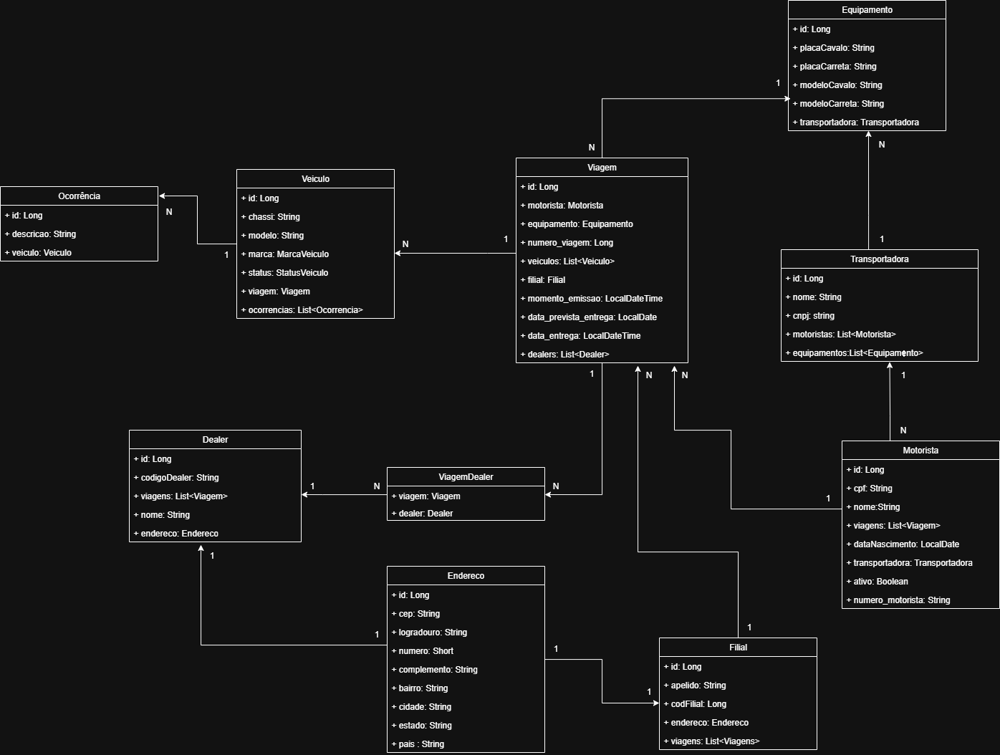

# 🚛 Transporte de Veículos — API REST

API REST desenvolvida em Java e Spring Boot para gerenciamento das operações logísticas de uma transportadora de veículos. O projeto centraliza o planejamento e o acompanhamento de viagens, relacionando motoristas, equipamentos, veículos, filiais e dealers (revendas), com validações para garantir a consistência das operações.

O foco do projeto é aplicar conceitos de desenvolvimento Back-end na construção de uma API orientada a regras de negócio, com persistência relacional, versionamento do banco de dados e integração com serviços externos.
## Tecnologias

- Java 17
- Spring Boot 3.5.0
- Spring Web
- Spring Data JPA (Hibernate)
- H2 Database (modo arquivo)
- Flyway
- WebClient (spring-webflux), usado de forma bloqueante para consumir o ViaCEP
- springdoc-openapi (Swagger UI)
- Lombok
- Spring Boot DevTools
- Maven

Já adicionados ao projeto, mas ainda não utilizados: Thymeleaf e spring-boot-starter-test.

## Modelagem

A viagem é a entidade central, porque a operação é controlada a partir dela. Cada viagem se liga a um motorista, um equipamento (cavalo mecânico + carreta), uma filial, veículos e dealers. `ViagemDealer` é a entidade de relacionamento entre viagem e dealer.



## Funcionalidades

- Gerenciamento de viagens, motoristas, veículos, equipamentos, filiais e dealers.
- Validação de motoristas ativos e bloqueio de viagens simultâneas não finalizadas.
- Controle de disponibilidade de equipamentos vinculados a viagens pendentes.
- Associação de veículos às viagens, com limite máximo de 11 veículos por viagem.
- Controle de status dos veículos, desde o estoque até a alocação para transporte.
- Finalização de viagens com registro de data e hora de entrega.
- Integração com a API ViaCEP para preenchimento automático de endereços a partir do CEP.
- Persistência com Spring Data JPA e versionamento do banco de dados com Flyway.e

## Integração com o ViaCEP

O cadastro de endereço utiliza a API pública ViaCEP para preencher automaticamente os dados de localização a partir do CEP informado.

O cliente precisa fornecer apenas:
- CEP
- Número
- Complemento

Os dados retornados pelo ViaCEP, como logradouro, bairro, cidade e estado, são utilizados no preenchimento do endereço.

A integração reduz a quantidade de informações que precisam ser digitadas manualmente e permite praticar o consumo de APIs externas com WebClient.

Exemplo de retorno do ViaCEP para `https://viacep.com.br/ws/01310200/json/`:

```json
{
  "cep": "01310-200",
  "logradouro": "Avenida Paulista",
  "complemento": "de 1512 a 2132 - lado par",
  "unidade": "",
  "bairro": "Bela Vista",
  "localidade": "São Paulo",
  "uf": "SP",
  "estado": "São Paulo",
  "regiao": "Sudeste",
  "ibge": "3550308",
  "gia": "1004",
  "ddd": "11",
  "siafi": "7107"
}
```

Se o CEP não for encontrado:

Quando consultado um CEP de formato inválido, exemplo: "950100100" (9 dígitos), "95010A10" (alfanumérico), "95010 10" (espaço), o código de retorno da consulta será um 400 (Bad Request). Antes de acessar o webservice, valide o formato do CEP e certifique-se que o mesmo possua {8} dígitos. Exemplo de como validar o formato do CEP em javascript está disponível nos exemplos abaixo.

Quando consultado um CEP de formato válido, porém inexistente, por exemplo: "99999999", o retorno conterá um valor de "erro" igual a "true". Isso significa que o CEP consultado não foi encontrado na base de dados. 

## Documentação da API

Com a aplicação rodando, a documentação fica em http://localhost:8080/swagger-ui/index.html

## ▶️ Como executar o projeto

### Pré-requisitos

- JDK 17;
- Git;
- Maven, caso não utilize o Maven Wrapper.

### 1. Clone o repositório

```bash
git clone https://github.com/arthuzxn/transporte-veiculos.git
cd transporte-veiculos
```

### 2. Configure as variáveis de ambiente

No arquivo `application.properties`, configure as credenciais do banco de dados:

```properties
spring.datasource.username=${DATABASE_USERNAME}
spring.datasource.password=${DATABASE_PASSWORD}
```

Defina as variáveis de ambiente `DATABASE_USERNAME` e `DATABASE_PASSWORD` no sistema operacional ou na configuração de execução da IDE.

### 3. Prepare o banco de dados

Crie a pasta `data` na raiz do projeto, caso ainda não exista, para armazenar os arquivos do banco H2.

As migrations do Flyway serão executadas durante a inicialização da aplicação, conforme a configuração do projeto.

### 4. Execute a aplicação

**Windows:**

```bash
mvnw.cmd spring-boot:run
```

**Linux / macOS:**

```bash
./mvnw spring-boot:run
```

Após a inicialização, a API estará disponível em:

`http://localhost:8080`

A documentação poderá ser acessada em:

`http://localhost:8080/swagger-ui/index.html`
## Autor

Arthur de Oliveira Gomes

https://www.linkedin.com/in/arthur-oliveira-gomes
